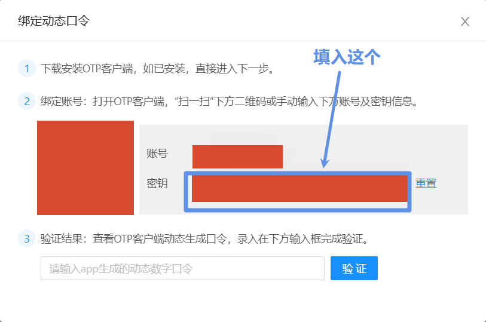

# iCourse Subscriber V2

自动监控复旦大学 iCourse 智慧教学平台的课程更新，对新课次的录播视频进行**语音转文字 + PPT OCR + AI 摘要**，并通过邮件推送到你的邮箱。

部署在 GitHub Actions 上，每天定时运行，**零成本、免服务器、全自动**。

> [!NOTE]
> 本项目严禁大规模传播（例如，不准分享到树洞、班级群、大群等地），否则信息办可能随时ban掉该项目。
> 如果该项目对你有用，请点个**star**⭐作为对作者的鼓励，并将项目**单独**分享给你的好朋友。

## 它能做什么？

假设你选了「摸鱼学导论」和「躺平学原理」两门课。在每天设定的时间，iCourse Subscriber 会自动：

1. 登录你的复旦 iCourse 账号（通过 WebVPN）
2. 检查这两门课是否有新的录播视频
3. 如果有：提取音频 → 语音识别 → 提取 PPT 图片 → OCR 转写 → AI 生成课程笔记
4. 将所有新课次的笔记汇总成**一封邮件**发送给你

邮件包含专业排版的 Markdown 渲染内容（含 LaTeX 公式渲染）。如果老师提到了作业、考试、签到、组队等重要课程事项，会在笔记开头醒目标注。

## 快速部署（5 分钟）

### 第 1 步：Fork 本仓库

点击页面右上角的 **Fork** 按钮，将仓库复制到你的 GitHub 账号下。

### 第 2 步：配置 Secrets

进入你 Fork 后的仓库，点击 **Settings → Secrets and variables → Actions → New repository secret**，逐个添加以下 Secret：

| Secret 名称 | 必填 | 说明 | 示例 |
|---|---|---|---|
| `STUID` | ✅ | 复旦学号 | `22307110000` |
| `UISPSW` | ✅ | UIS 统一身份认证密码 | `your_password` |
| `UIS_TOTP_SECRET` | ✅ | 二次验证要求的动态口令（OTP）（见下） | `XXW33***********` |
| `COURSE_IDS` | ✅ | 要监控的课程 ID，多个用英文逗号分隔 | `35472,30251` |
| `DASHSCOPE_API_KEY` | ⬜ | ModelScope 平台 API Key | `ms-xxxxxxxx` |
| `DEEPSEEK_API_KEY` | ⬜ | DeepSeek API Key（推荐） | `sk-xxxxxxxx` |
| `GEMINI_API_KEY` | ⬜ | Gemini API Key | `AIza...` |
| `SMTP_EMAIL` | ✅ | 用于发送邮件的 QQ 邮箱 | `123456@qq.com` |
| `SMTP_PASSWORD` | ✅ | QQ 邮箱 SMTP **授权码**（不是登录密码） | `abcdefghijklmnop` |
| `RECEIVER_EMAIL` | ✅ | 接收摘要邮件的邮箱 | `you@m.fudan.edu.com` |

> 至少配置一个 LLM API Key（DASHSCOPE、DEEPSEEK 或 GEMINI）。程序按配置顺序自动回退尝试。如果需要选择其他的LLM供应商，可以在`src\runtime\config.py`路径下自定义供应商。

#### 配置动态口令二次验证（TOTP）

> 2026/11/09 iCourse 平台升级了登录策略，要求所有账号在密码验证后进行二次验证（TOTP），我们采用 TOP 登录的方法进行二次验证

进入 [UIS 个人中心的账号安全页面](https://id.fudan.edu.cn/uc/#/pc/userCenter/accountSecurity)，在「动态口令」中按提示完成绑定，并保存绑定时获取的 **Base32 密钥**，按上述的 Secrets 填入 `UIS_TOTP_SECRET` 即可

### 第 3 步：获取课程 ID

登录 [iCourse 网页版](https://icourse.fudan.edu.cn)，进入你要监控的课程页面，URL 中的数字就是课程 ID：

多门课用英文逗号隔开：`35472,30251,40123`

### 第 4 步：获取 API Key

选择一个或多个模型服务商：

| 服务商 | 获取方式 | 免费额度 |
|---|---|---|
| **ModelScope**（`DASHSCOPE_API_KEY`） | [API 密钥管理](https://modelscope.cn/my/myaccesstoken) | 每天 2000 次免费调用，推荐 |
| **DeepSeek**（`DEEPSEEK_API_KEY`） | [DeepSeek Platform](https://platform.deepseek.com/) | 注册赠额度 |
| **Gemini**（`GEMINI_API_KEY`） | [Google AI Studio](https://aistudio.google.com/) | flash模型每日免费额度 |

### 第 5 步：获取 QQ 邮箱 SMTP 授权码

1. 登录 [QQ 邮箱](https://mail.qq.com) → 设置 → 账户与安全 → 安全设置
2. 找到「POP3/IMAP/SMTP/Exchange/CardDAV/CalDAV 服务」
3. 开启 SMTP 服务，按提示获取**授权码**（16 位字母）
4. 将授权码填入 `SMTP_PASSWORD`

### 第 6 步：运行

- **自动运行**：默认每天 19:36（北京时间）自动执行
- **手动触发**：进入仓库 → Actions → **iCourse Check** → Run workflow
- **立即触发**：也可通过前端页面点击「触发订阅检查」按钮

首次运行会处理所有已有录播，后续只处理新增课次。

## 前端页面（索引与查看）

本项目自带一个浏览器端加密数据库查看器，部署在 GitHub Pages：

访问 `https://你的用户名.github.io/Fudan_iCourse_Subscriber/`

功能介绍：
- **浏览器端解密**：输入你的凭据，浏览器用 WebCrypto 解密 sql.js 读取 shard 数据库，凭据不离开本地
- **按课程/课次浏览**：查看每节课的转录和摘要内容
- **导出 PDF**：通过 GitHub Actions 触发导出工作流，生成格式化课程笔记 PDF 并邮件发送

> 前端页面需要你手动在 GitHub Pages 设置中开启（Settings → Pages → Source → GitHub Actions），然后触发一次 Deploy Frontend workflow 即可部署。

> [!TIP]
>
> ## V2 更新说明
>
> - 重构了代码架构，清晰的分层化设计。
>
> - 更新了 ASR 系统，引入插件化后端机制，目前支持 SenseVoice（默认）、FireRed 与 Zipformer 三种后端，并新增统一的跨后端后处理流程。
>
> - 引入了 PPT OCR 流水线和清洗机制，通过 PPT 信息引导模型生成更丰富的课程总结。
>
> - 引入新的调度系统，以改善 GitHub Actions 低核数环境下的吞吐与稳定性。
>
> - 更新了数据库结构，从原本的单文件数据库演进为按课程约 10MB 的分片结构，支持前端增量加载与按需读取，降低课程加载开销。
>
> - 新增 GitHub Pages 前端查看器，支持加密数据库浏览、订阅编辑器与 PDF 导出等功能。
>
> - 更新了 LLM 调度逻辑，将原本的单一 provider 调用改为多 provider 列表式自动回退机制。
>
> - 设计了完善的版本过渡机制，V1 可以直接升级为 V2，程序会自动处理所有兼容性问题。

> [!CAUTION]
> **⚠️ 合规使用声明**
>
> 本项目的设计初衷仅为辅助本校学生进行**个人的日常学习与复习**与进行技术交流。程序采用"封闭容器、流式处理、阅后即焚"的架构，默认不保存任何视频文件。任何人在部署和使用本项目时，必须严格遵守《复旦大学智慧教学资源平台使用规范》及相关校纪校规。**严禁使用者利用本程序进行以下违规操作，一切因滥用导致的账号封禁或纪律处分（如通报批评、限制平台权限等），均由使用者自行承担，与本仓库及作者无关：**
>
> * **严禁二次分发与传播**：《规范》第二部分明确指出，平台教学资源属于职务作品，未经许可不得传播。**禁止**将推送到你邮箱的课程摘要、转录文本或笔记转发给他人，或发布到任何公共网络平台。
> * **严禁修改代码非法下载视频**：《规范》严禁未经许可对平台资源进行复制和下载。基于此，本项目并不留存视频，**严禁**任何人修改源代码将受版权保护的课程录播违规下载、保存到任何本地或云端存储介质。
> * **严禁解密或泄露数据库**：仓库中的 `icourse.db.enc` 仅用于程序追踪课次进度避免重复计算。**严禁**手动解密该数据库以提取、滥用或公开其中的转录和摘要文本信息。
> * **注意账号环境安全**：本程序会使用你的 UIS 凭证进行云端 WebVPN 自动化登录，有触发异地登录风控的可能。请妥善保管个人 Secret，因使用云端自动化服务导致的账号异常风险由使用者自行评估。
>
> **当你 Fork 并配置 Secret 运行本项目时，即代表你已知晓上述风险，并承诺仅在授权范围内为个人学习目的使用本工具，遵守相关校纪校规。**
